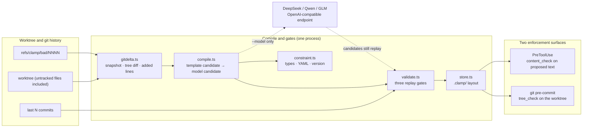

<div align="center">

English | [简体中文](README.md)


# Clamp

**Compile one human correction into a trigger plus a machine check, so the next run stops the same mistake**

<a href="https://github.com/SuperMarioYL/clamp"></a>

[](#install)
[](#install)
[](https://github.com/SuperMarioYL/clamp/actions/workflows/ci.yml)
[](https://github.com/SuperMarioYL/clamp/releases)
[](#install)
[](./LICENSE)

[Why](#why) · [How it works](#how-it-works) · [Install](#install) · [Quickstart](#quickstart) · [Demo](#demo) · [Usage](#usage) · [Configuration](#configuration) · [How it differs](#how-it-differs) · [Roadmap](#roadmap) · [Team edition and pricing](#team-edition-and-pricing)

</div>

---

##  Why

A three-to-five person team runs Claude Code across many sessions. The agent glues a timestamp together in `src/report.ts` with `toISOString()`. You rewrite that line to `formatDate()`, drop one sentence into the session — "don't build dates by hand, always use formatDate" — and move on. The next day a new session writes `toISOString()` again in `src/digest.ts`. Same mistake, same person corrected it, third round of rework.

This is not the model failing to see the rule. Skills, `AGENTS.md` and `CLAUDE.md` all put the rule into the context window; the model has genuinely read it. Reading it is not doing it. Audit-style tools (the ones that record what the agent changed and said) can only tell you what happened. The missing layer is **enforcement**: turn the sentence into an action before the write and before the commit.

Clamp sits on that layer. `clamp fix` records the worktree (untracked files included) at the moment you correct it. `clamp compile` compiles that sentence together with your fix diff into one constraint: a trigger and two checks that express the same claim. From then on every agent run or `git commit` is stopped at the same place — not because you remembered to remind the agent, but because the harness says it for you.

One correction goes through four actions, all of which you were doing anyway:

1. The agent writes the mistake, you correct it (already part of the job).
2. `clamp fix` records the bad state together with the sentence.
3. `clamp compile` builds a candidate, replays it three ways, and waits for your confirmation.
4. The next instance of the same mistake becomes exit 2 before the write or before the commit.

##  How it works

A single-process CLI, one npm package, no daemon, no database. The only network call is the optional OpenAI-compatible request made by `compile --model`.



Four invariants are enforced by code, not by convention:

1. **No replay, no constraint.** The bad version must fire (`fires_on_bad`), the fixed worktree must pass (`passes_on_good`), and the last 40 commits must produce zero false blocks (`baseline_blocks = 0`). All three must hold before anything is written. `--force` may downgrade a failed candidate to `warn`; it can never store it as `block`.
2. **Checks read exit codes, and the expectation is explicit.** `expect` is either `match` or `no_match`. `git grep` exits 0 on a match, 1 on no match, 128 on an invalid regex, so under `no_match` only exit 1 passes; 128, any other unexpected code and a timeout mean the check itself broke and count as a failure (fail closed). The trigger only decides whether a check is worth running — it never decides the verdict, so there is no path where a model is the judge.
3. **The two surfaces each get their own check; they cannot be merged into one diff check.** Claude Code `PreToolUse` runs before the write and only has the proposed text (Write's `tool_input.content`, Edit's `tool_input.new_string`) plus `tool_input.file_path` — there is no diff at that moment. pre-commit only has the worktree after the write. A constraint therefore carries both `content_check` (regex over proposed text) and `tree_check` (command over the worktree); a hit on either one fails.
4. **Enforcement has two levels.** `block` exits 2 on a hit; `warn` only prints. Conflicting constraints are reported side by side, never auto-resolved.

Three git details that are easy to get wrong and are handled here:

- A snapshot cannot rely on `git stash create`. It does not capture untracked files, and when the only change is a brand-new file it prints an empty SHA and exits successfully. Clamp uses a temporary index (`GIT_INDEX_FILE` + `git add -A` + `git write-tree` + `git commit-tree`), exits with an error on an empty tree, and never writes an empty ref.
- The pathspec inside `tree_check` must be `:(glob)src/**/*.ts` or explicit paths. A bare `src/**/*.ts` is read as two `*` around a literal `/`, requires at least one subdirectory, and misses `src/report.ts`.
- `git grep` only sees tracked files, so the command carries `--untracked`, and the flag must come before the pattern. `git commit -am` never stages a new file either, which is why the pre-commit tree check looks at the worktree instead of only the index.

##  Install

```sh
# install from GitHub (the shipping channel for v0.1.0)
npm install -g github:SuperMarioYL/clamp

# or run it without installing
npx --yes github:SuperMarioYL/clamp init
```

The bare npm name `clamp` belongs to an unrelated package; this project publishes as
`@supermarioyl/clamp` (not yet on the registry — once it is, `npm i -g @supermarioyl/clamp` works).

Requires Node.js ≥ 20 (CI covers 20 and 22), git, and macOS / Linux / WSL. Native Windows shells are outside what v0.1 guarantees.

From source (before the first release, or when you want to change the code):

```sh
git clone https://github.com/SuperMarioYL/clamp.git
cd clamp
npm ci
npm run build
npm link        # `clamp` is then on your PATH
```

##  Quickstart

The full loop: create a repo, write bad code, `fix`, `compile`, `replay`, then commit the same mistake and get stopped by pre-commit. Every output below comes from a real v0.1.0 run; see [Demo](#demo) for the recording.

Start with a repository. The history feeds the baseline sample, so create all 40 commits, same as the recording:

```sh
mkdir clamp-demo && cd clamp-demo
git init -q -b main
mkdir -p src notes

cat > src/format.ts <<'TS'
export function formatDate(value: Date): string {
  const y = value.getFullYear();
  const m = String(value.getMonth() + 1).padStart(2, "0");
  const d = String(value.getDate()).padStart(2, "0");
  return `${y}-${m}-${d}`;
}
TS
cat > src/report.ts <<'TS'
import { formatDate } from "./format.js";

export function renderReport(d: Date): string {
  return "Report " + formatDate(d);
}
TS
git add -A
git commit -qm "render report with formatDate"

for i in $(seq 1 39); do
  echo "note $i" > "notes/note-$i.md"
  git add -A
  git commit -qm "notes: add note $i"
done
```

**1. Initialize.** Writes `.clamp/`, installs the git pre-commit hook, and prints the hooks snippet for Claude Code's `settings.json`:

```console
$ clamp init
Clamp v0.1.0 · wrote .clamp/
pre-commit  /private/tmp/clamp-demo/.git/hooks/pre-commit
Claude Code  add this to settings.json so writes are checked before they happen:
```

`init` then prints the `PreToolUse` hooks JSON on stdout; the complete snippet is under [Configuration](#configuration). The `pre-commit` path will be your own repository's path.

**2. The agent leaves bad code behind.** One tracked file is modified, one new file is still untracked:

```sh
cat > src/report.ts <<'TS'
export function renderReport(d: Date): string {
  return "Report " + d.toISOString();
}
TS
cat > src/digest.ts <<'TS'
export function renderDigest(d: Date): string {
  return "Digest " + d.toISOString();
}
TS
```

**3. Record the bad state together with your sentence.** The snapshot goes to `refs/clamp/bad/<id>`; the worktree is untouched and no commit is created:

```console
$ clamp fix --words "时间别自己拼，统一用 formatDate"
snapshot refs/clamp/bad/5eb0 · 4 added lines
  src/digest.ts:1  export function renderDigest(d: Date): string {
  src/digest.ts:2  return "Digest " + d.toISOString();
  src/digest.ts:3  }
  src/report.ts:2  return "Report " + d.toISOString();
after fixing the code, run: clamp compile 5eb0
```

**4. Fix it by hand, then compile the correction.** The compiler derives a span trigger from the added lines, builds `content_check` and the negative `tree_check`, replays all three gates and waits for your confirmation:

```console
$ clamp compile 5eb0
candidate 0001-no-raw-toisostring  span  src/**/*.ts  /\.toISOString\(\)/
content_check  /\.toISOString\(\)/  (PreToolUse, before the write)
tree_check     git grep --untracked -nE '\.toISOString\(\)' -- ':(glob)src/**/*.ts'  (expect: no_match, 30s)
replay    fires_on_bad yes · passes_on_good yes · baseline 40 commits · 0 blocks · 0 trigger hits
accept? [y/N] y
written   .clamp/constraints/0001-no-raw-toisostring.yaml
```

In a non-interactive environment (CI, scripts) use `clamp compile 5eb0 --yes` to skip the prompt. Without `--yes` and without a terminal it writes nothing.

**5. Re-check the constraint whenever you want.** `replay` reruns the three gates and reports the trigger hit count as a cost metric:

```console
$ clamp replay 0001
constraint 0001-no-raw-toisostring  version b907c261831d  block
fires_on_bad    yes  src/digest.ts:2 (+1 more)
passes_on_good  yes
baseline        40 commits · 0 blocks · 0 trigger hits
verdict         pass
```

**6. The next instance is stopped.** A new session writes `toISOString()` again; in a harness without `PreToolUse`, pre-commit is the fallback:

```console
$ git add -A && git commit -m "feat: weekly digest"
0001-no-raw-toisostring  blocked  src/digest.ts:2:  return "Digest " + d.toISOString();
  check failed: git grep --untracked -nE '\.toISOString\(\)' -- ':(glob)src/**/*.ts'
clamp: blocked the commit (exit 2) — 1 constraint(s) refused it.
clamp: fix the offending lines, or run `clamp fix --words "..."` if the rule itself is wrong.
```

The hook exits 2 and the commit is aborted (`git commit` itself returns 1 at that point). In a session with the hook installed, the same Edit is stopped before it is written, so it never reaches a commit. Going from `clamp init` to this point is meant to take under ten minutes.

A snapshot id comes from the tree hash, so it is reproducible for identical content. A constraint's `version` includes the creation time and changes on every compile. The `baseline` numbers come from your repository's real history.

##  Demo

[`assets/demo.cast`](assets/demo.cast) is a 44-second asciinema recording (v2 format) of the loop above, plus the pre-write block when the hook is installed:

```sh
asciinema play assets/demo.cast
# or just read the text
asciinema cat assets/demo.cast
```

| Time | What happens on screen |
| --- | --- |
| 0–7s | `clamp init` writes `.clamp/`, installs pre-commit, prints the Claude Code hooks snippet |
| 7–15s | `clamp fix` records the bad state; one of the 4 added lines comes from the untracked `src/digest.ts` |
| 15–24s | `clamp compile` derives the trigger and both checks, the gates pass, `y` stores it |
| 25–33s | In a harness without `PreToolUse`, `git commit` is stopped by `tree_check` |
| 33–44s | In a session with the hook, the same Edit is stopped by `content_check` before the write |

The key lines from both blocks at the end of the recording:

```text
0001-no-raw-toisostring  blocked  src/digest.ts:2:  return "Digest " + d.toISOString();
  check failed: git grep --untracked -nE '\.toISOString\(\)' -- ':(glob)src/**/*.ts'
clamp: 0001-no-raw-toisostring  src/digest.ts  content_check /\.toISOString\(\)/ matched "const stamp = d.toISOString();"
```

To rerun the smallest version locally, [`examples/replay-repo`](examples/replay-repo/README.md) contains a broken `src/format.ts` and reproduction notes. The recording was made in a temporary directory on this machine; snapshot ids match locally, versions and timestamps do not.

##  Usage

```text
clamp — compile a human correction into a check that keeps running

usage:
  clamp init                     create .clamp/ and install the git pre-commit gate
  clamp fix [--words "..."]      snapshot the worktree (untracked files included)
  clamp compile <snapshot>       compile a candidate check and replay it three ways
        [--words "..."] [--model] [--yes] [--force] [--baseline N]
  clamp replay <constraint>      replay a stored constraint against bad, good and history
  clamp check [--staged]         run every tree_check against the worktree or the index
  clamp list                     list stored constraints
  clamp hook pre-commit          run tree_check (git pre-commit)
  clamp hook pre-tool-use        run content_check on the event's proposed text (stdin)
  clamp --version
```

| Command | What it does | Exit codes |
| --- | --- | --- |
| `clamp init` | Creates `.clamp/constraints/` and installs pre-commit into the directory `git rev-parse --git-path hooks` resolves (honouring `core.hooksPath`). An existing hook is renamed to `pre-commit.clamp-prev` and runs first. Prints the Claude Code hooks snippet | 0 ok, 1 not a git repository |
| `clamp fix` | Records the whole worktree (untracked files included) through a temporary index and writes the ref `refs/clamp/bad/<id>`; `--words` is stored in the snapshot's commit message | 0 ok, 1 worktree unchanged or empty (no ref written) |
| `clamp compile` | Derives a candidate from the added lines of the snapshot diff and runs the three replay gates. `--yes` skips confirmation, `--force` stores a candidate that failed replay as `warn` (a candidate refused by the scope gate cannot be forced), `--baseline N` changes the sampled commit count (default 40), `--model` asks a model after the template fails | 0 written, 1 nothing written (declined / not a terminal), 2 gates refused |
| `clamp replay` | Reads a constraint by id or file path and reruns the three gates against the bad snapshot, the current worktree and history; prints the trigger hit count | 0 pass, 2 fail |
| `clamp check` | Runs every `tree_check`. `--staged` materialises the index as a temporary commit first, for CI and pre-push | 0 pass, 2 a `block` violation |
| `clamp list` | Lists constraint id, enforcement, trigger and version | 0 |
| `clamp hook pre-commit` | The entry point pre-commit calls; equivalent to `check` over the worktree | 0 allow, 2 block |
| `clamp hook pre-tool-use` | Reads the Claude Code `PreToolUse` JSON from stdin and runs `content_check` over `tool_input.content` / `new_string` | 0 allow, 2 block |
| `clamp --version` | Prints the version; `--help` / `-h` prints the usage above, which is also what you get with no arguments | 0 (1 with no arguments) |

`clamp check` runs `tree_check` only, never `content_check`: the latter needs proposed text, which exists only in a hook event. `warn` constraints print on both paths but never make a command exit 2.

##  Configuration

### The `.clamp/` layout

```text
.clamp/
└── constraints/
    └── 0001-no-raw-toisostring.yaml
```

`.clamp/` holds constraint files only. A snapshot is not a file; it is the git ref `refs/clamp/bad/<id>`, and the correction words live in that snapshot's commit message. There is no side state that can drift, and nothing leaks into your commit history.

A constraint that was really stored:

```yaml
id: 0001-no-raw-toisostring
claim: 时间别自己拼，统一用 formatDate
enforcement: block
trigger:
  kind: span
  glob: src/**/*.ts
  pattern: \.toISOString\(\)
content_check:
  pattern: \.toISOString\(\)
tree_check:
  cmd: git grep --untracked -nE '\.toISOString\(\)' -- ':(glob)src/**/*.ts'
  timeout_sec: 30
  expect: no_match
provenance:
  bad_ref: refs/clamp/bad/5eb0
  good_ref: worktree
  words: 时间别自己拼，统一用 formatDate
  model: template
  base: 2bbb53ef472c55a7cf4e1accd6222ca4425c1367
  created_at: 2026-11-12T04:40:03.844Z
version: b907c261831d
```

| Field | Meaning |
| --- | --- |
| `trigger` | `span` matches a regex against added lines (replay) or proposed text (PreToolUse), scoped by `glob`; `path` means touching this kind of file is enough. v0.1 has no AST triggers |
| `content_check` | Runs before a write: a regex hit on the proposed text fails |
| `tree_check` | Runs before a commit: the command's exit code is interpreted through `expect`; a `timeout_sec` timeout is a check error |
| `enforcement` | `block` exits 2 on a hit; `warn` only prints |
| `provenance` | Snapshot ref, diff base, original correction, candidate source (`template` or a model name) |
| `version` | First 12 hex chars of the constraint's sha256, including the timestamp, so it changes per compile; block logs can say which version stopped them |

### What `expect` means

`expect` is not "the command succeeded". It states which result counts as a pass:

| `expect` | exit 0 | exit 1 | 128 / 127 / other / timeout |
| --- | --- | --- | --- |
| `match` | pass | fail | check error, treated as a failure |
| `no_match` | fail (something still matches) | pass | check error, treated as a failure |

`exit0` is an alias for `match`, so older files still load. The trigger only decides whether to run a check; the verdict comes from the exit code alone, and no model participates.

### Installing the hooks

`clamp init` does two things:

1. Writes `pre-commit` into the directory `git rev-parse --git-path hooks` returns. This honours `core.hooksPath` and works in linked worktrees, where `.git` is a file and a hard-coded `<repo>/.git/hooks` cannot be installed. An existing hook is preserved as `pre-commit.clamp-prev` and runs first.
2. Prints the Claude Code `PreToolUse` configuration to paste into `settings.json`:

```json
{
  "hooks": {
    "PreToolUse": [
      {
        "matcher": "Write|Edit",
        "hooks": [{ "type": "command", "command": "clamp hook pre-tool-use" }]
      }
    ]
  }
}
```

pre-commit is harness-agnostic: repositories driven by Codex, Tongyi Lingma, Trae or CodeBuddy all pass through it on `git commit`, which is the general fallback. Claude Code additionally gets the pre-write block. The hook looks for the CLI at `node_modules/.bin/clamp`, then `clamp` on `PATH`; `CLAMP_BIN` overrides both (for example, pointing at `dist/cli.js`).

### Optional model

Only `clamp compile --model` reaches the network. The endpoint speaks the OpenAI-compatible protocol and is configured with three environment variables:

| Variable | Purpose |
| --- | --- |
| `CLAMP_BASE_URL` (or `CLAMP_MODEL_BASE_URL`) | Endpoint root, default `https://api.deepseek.com/v1` |
| `CLAMP_MODEL` | Model name, default `deepseek-chat` |
| `CLAMP_MODEL_API_KEY` | API key; when unset Clamp says so and falls back to the template candidate |

| Backend | `CLAMP_BASE_URL` | `CLAMP_MODEL` example |
| --- | --- | --- |
| DeepSeek | `https://api.deepseek.com/v1` | `deepseek-chat` |
| Qwen (DashScope compatible mode) | `https://dashscope.aliyuncs.com/compatible-mode/v1` | `qwen-plus` |
| GLM | `https://open.bigmodel.cn/api/paas/v4` | `glm-4-plus` |
| Self-hosted vLLM | `http://127.0.0.1:8000/v1` | your model name |

The model produces a candidate only (one regex, one glob, one claim), and that candidate still goes through the same three replay gates. When the endpoint is unreachable, Clamp falls back to the template and says why.

##  How it differs

Clamp does not replace any of the layers below; it fills the gap where one correction becomes an executable check:

| Approach | What it solves | What it leaves open |
| --- | --- | --- |
| `AGENTS.md` / `CLAUDE.md` / Skill | Puts project knowledge into the context so the model has read it | Reading is not doing; a new session can repeat the mistake, and more rules dilute each other |
| ESLint and similar linters | Existing general rules and style constraints | Today's sentence is not a rule yet, and turning it into one takes extra work; a linter also does not know about that one project-specific fix |
| CI | A full gate before merge | Feedback arrives late; it covers neither "before the write" nor local commits |
| Post-hoc audit tools | Record what the agent changed and why | They inform you afterwards; they do not change the next run |
| **Clamp** | One correction → trigger + two checks → enforced before the write and at commit time | Only patterns you explicitly corrected and can express as a regex or command; no inference, no automatic code changes |

The boundaries, stated plainly:

- v0.1 triggers are `span` (regex over added lines / proposed text) and `path` (glob). No AST queries.
- No automatic edits, no automatic agent re-runs, no automatic repair of a blocked patch.
- No LLM-as-judge: checks read exit codes only.
- Conflicting constraints are reported side by side, never auto-resolved.
- Native Windows shells are unsupported; WSL is treated as Linux.

##  Roadmap

**v0.1.0 (current, implemented)**

- Snapshot and replay: a temporary index records the worktree including untracked files, an empty tree exits with an error, and three gates replay the constraint.
- Deterministic compile: with zero API keys, derive a span trigger, `content_check` and the negative `tree_check` from added lines.
- Store gate: candidates that are too broad (all of `src/`) or too narrow (a misspelled function name) are refused with the failing gate named; the baseline samples 40 commits.
- Two enforcement surfaces: `content_check` in Claude Code `PreToolUse`, `tree_check` in git pre-commit, exit 2 on a hit.
- Optional model: DeepSeek / Qwen / GLM / self-hosted vLLM through an OpenAI-compatible endpoint; output still replays, with a clear fallback to the template.

**v0.2 (planned)**

- `compile` derives `path` triggers automatically, covering "touching this kind of file must come with a test".
- Edit, disable and delete constraints through the CLI instead of hand-editing YAML.
- A readable conflict report: several rules for one claim shown side by side with a merge suggestion.
- Ready-made pre-push and CI snippets (`clamp check --staged` already exists; add GitHub Actions and Gitee Go examples).

**v0.3 and later (planned, not implemented)**

- Team constraint registry: cross-repository sync, versioned block audits, a shared CI gate, a private model gateway.

Explicitly out of scope: web UI, accounts, plugin marketplace, AST triggers, native Windows shells, automatic fixes, LLM judging.

##  Team edition and pricing

The v0.1 CLI is open source. Compiling, replaying and enforcing inside one repository all happen on your machine, with no paywall. What you pay for is the team layer, once "is the same correction consistent across three people and five repositories" starts to matter:

- **Private constraint registry.** Constraints are reviewed with code, synced across repositories, and inherited by new repositories.
- **Block audits.** Who was stopped in which file by which constraint version, and how many false blocks there were, as a weekly report instead of chat history.
- **A shared CI gate and a private model gateway.** One `check` for the team, model requests that never leave the intranet.

Pricing (an early hypothesis from the team conversations in progress): **¥199 per seat per month, ¥1,990 per seat per year, minimum five seats**. The self-hosted edition stays as the entry point; the team edition is priced per seat. v0.1 ships neither billing nor hosted services.

If you have three or more repositories and a team of five or more, and you rework the same class of mistake every week, open an issue describing your correction flow — this roadmap follows that feedback first.

<div align="center">

<a href="./LICENSE">MIT</a> © 2026 SuperMarioYL

</div>
