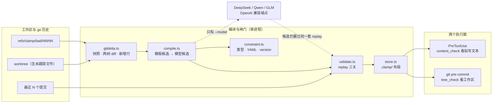

<div align="center">

简体中文 | [English](README.en.md)


# Clamp

**把一句人工纠正编译成触发点加机器检查，下一次运行直接拦下同类错误**

<a href="https://github.com/SuperMarioYL/clamp"></a>

[](#安装)
[](#安装)
[](https://github.com/SuperMarioYL/clamp/actions/workflows/ci.yml)
[](https://github.com/SuperMarioYL/clamp/releases)
[](#安装)
[](./LICENSE)

[为什么需要它](#为什么需要它) · [工作原理](#工作原理) · [安装](#安装) · [快速开始](#快速开始) · [演示](#演示) · [用法](#用法) · [配置](#配置) · [与现有方案的区别](#与现有方案的区别) · [路线图](#路线图) · [团队版与付费](#团队版与付费)

</div>

---

##  为什么需要它

一个用 Claude Code 跑多会话的 3–5 人小队，agent 在 `src/report.ts` 里手拼时间串，用了 `toISOString()`。你把那行改回 `formatDate()`，在会话里丢下一句“时间别自己拼，统一用 formatDate”。第二天新会话，agent 在 `src/digest.ts` 里又写了一遍 `toISOString()`——同一个错误，同一个人纠正过，第三次返工。

这不是模型没看到规则。Skill、`AGENTS.md`、`CLAUDE.md` 都会把规则塞进上下文，模型确实“看过”，但看过不等于执行。事后审计类的工具（记录 agent 改了什么、说了什么）也只能告诉你它做过什么。缺的那一层是**执行面**：在写之前、在提交之前，用一条可运行的检查把话变成动作。

Clamp 接的就是这一层。`clamp fix` 在你纠正的当下把工作区（含未跟踪的新文件）存成快照，`clamp compile` 把这句话连同你随后的修复 diff 编译成一条约束：一个触发点，加上两条表达同一 claim 的检查。此后每次 agent 运行或 `git commit`，都在同一个地方把它拦住——不是你记得提醒 agent，而是 harness 替你说。

一次纠正会走完四个动作，都是你本来就在做的事：

1. agent 写错，你把它改对（原本就要做）。
2. `clamp fix` 记下坏状态，附带那句纠正。
3. `clamp compile` 生成候选，回放三关，你点头落盘。
4. 下一次同类错误在写入前或提交前变成 exit 2。

##  工作原理

单进程 CLI，一个 npm 包，零常驻服务，零数据库。唯一的网络调用是 `compile --model` 时对 OpenAI 兼容端点的可选请求。



四条不变量由代码强制，不靠约定：

1. **没有 replay 就没有约束。** 坏版本必须触发（`fires_on_bad`）、修好后的工作区必须通过（`passes_on_good`）、最近 40 个提交必须零误拦（`baseline_blocks = 0`），三项同时成立才允许写盘。`--force` 只能把约束降级成 `warn` 写进去，永远不能写 `block`。
2. **check 只认退出码，预期必须显式写出。** `expect` 只有 `match` 与 `no_match` 两种。`git grep` 匹配返回 0、无匹配返回 1、非法正则返回 128，因此 `no_match` 下只有 exit 1 是通过；128、其它非预期码、超时都算检查自身出错，按失败处理（fail closed）。触发点只决定“值不值得跑这条 check”，不参与判定，所以没有 LLM 当裁判的路径。
3. **两个执行面各一条 check，不能合并成一条 diff 检查。** Claude Code `PreToolUse` 在写之前触发，拿到的只有拟写文本（Write 的 `tool_input.content`、Edit 的 `tool_input.new_string`）与 `tool_input.file_path`，此刻没有 diff；pre-commit 只有写后的工作区。所以约束同时带 `content_check`（正则，跑拟写文本）与 `tree_check`（命令，跑工作区），命中任一即失败。
4. **enforcement 只有两级。** `block` 命中即 exit 2；`warn` 只打印不拦。冲突约束并列报告，不自动消解。

三个容易写错、这里已经处理掉的 git 细节：

- 快照不能只用 `git stash create`。它不抓未跟踪的新文件，当唯一改动就是新建文件时还会返回空 SHA 并成功退出。Clamp 用临时 index（`GIT_INDEX_FILE` + `git add -A` + `git write-tree` + `git commit-tree`），空树按错误退出，绝不写空 ref。
- `tree_check` 里的 pathspec 必须是 `:(glob)src/**/*.ts` 或显式路径。裸 `src/**/*.ts` 会被当成“两个 `*` 夹一个字面 `/`”，要求至少一层子目录，匹配不到 `src/report.ts`。
- `git grep` 默认只搜已跟踪文件，所以命令带 `--untracked`，`--untracked` 必须在 pattern 之前；`git commit -am` 不会暂存新文件，pre-commit 的树检查因此看工作区而不是只看暂存区。

##  安装

```sh
# 从 GitHub 安装（v0.1.0 的正式渠道）
npm install -g github:SuperMarioYL/clamp

# 或者不安装，直接用
npx --yes github:SuperMarioYL/clamp init
```

npm 上的 `clamp` 这个名字属于别的包，本项目的发布名是 `@supermarioyl/clamp`（尚未发布，发布后 `npm i -g @supermarioyl/clamp` 才可用）。

需要 Node.js ≥ 20（CI 覆盖 20 与 22）、git、macOS / Linux / WSL。Windows 原生 shell 不在 v0.1 的保证范围内。

从源码构建（正式发布前或需要改代码时）：

```sh
git clone https://github.com/SuperMarioYL/clamp.git
cd clamp
npm ci
npm run build
npm link        # 之后可以直接用 clamp
```

##  快速开始

下面是一个完整闭环：建仓库、写坏代码、`fix`、`compile`、`replay`、再犯一次被 pre-commit 拦下。所有输出都来自 v0.1.0 的真实运行，录制细节见[演示](#演示)。

先准备一个仓库。历史提交用来给 baseline 采样，这里造满 40 个，和录屏一致：

```sh
mkdir clamp-demo && cd clamp-demo
git init -q -b main
mkdir -p src notes

cat > src/format.ts <<'TS'
export function formatDate(value: Date): string {
  const y = value.getFullYear();
  const m = String(value.getMonth() + 1).padStart(2, "0");
  const d = String(value.getDate()).padStart(2, "0");
  return `${y}-${m}-${d}`;
}
TS
cat > src/report.ts <<'TS'
import { formatDate } from "./format.js";

export function renderReport(d: Date): string {
  return "Report " + formatDate(d);
}
TS
git add -A
git commit -qm "render report with formatDate"

for i in $(seq 1 39); do
  echo "note $i" > "notes/note-$i.md"
  git add -A
  git commit -qm "notes: add note $i"
done
```

**1. 初始化。** 写好 `.clamp/`，装上 git pre-commit，并打印要贴进 Claude Code `settings.json` 的 hooks 片段：

```console
$ clamp init
Clamp v0.1.0 · wrote .clamp/
pre-commit  /private/tmp/clamp-demo/.git/hooks/pre-commit
Claude Code  add this to settings.json so writes are checked before they happen:
```

`init` 随后把一段 `PreToolUse` 的 hooks JSON 打印到标准输出，完整内容见[配置](#配置)。`pre-commit` 的路径在你本地会是你自己的仓库路径。

**2. agent 留下坏代码。** 一个已跟踪文件被改，一个新文件还没被 git 跟踪：

```sh
cat > src/report.ts <<'TS'
export function renderReport(d: Date): string {
  return "Report " + d.toISOString();
}
TS
cat > src/digest.ts <<'TS'
export function renderDigest(d: Date): string {
  return "Digest " + d.toISOString();
}
TS
```

**3. 记下坏状态，连同你那句纠正。** 快照进 `refs/clamp/bad/<id>`，不动工作区、不产生提交：

```console
$ clamp fix --words "时间别自己拼，统一用 formatDate"
snapshot refs/clamp/bad/5eb0 · 4 added lines
  src/digest.ts:1  export function renderDigest(d: Date): string {
  src/digest.ts:2  return "Digest " + d.toISOString();
  src/digest.ts:3  }
  src/report.ts:2  return "Report " + d.toISOString();
after fixing the code, run: clamp compile 5eb0
```

**4. 手工改对，然后编译这次纠正。** 编译器从新增行推出 span 触发点，生成 `content_check` 与否定式 `tree_check`，回放三关后等你点头：

```console
$ clamp compile 5eb0
candidate 0001-no-raw-toisostring  span  src/**/*.ts  /\.toISOString\(\)/
content_check  /\.toISOString\(\)/  (PreToolUse, before the write)
tree_check     git grep --untracked -nE '\.toISOString\(\)' -- ':(glob)src/**/*.ts'  (expect: no_match, 30s)
replay    fires_on_bad yes · passes_on_good yes · baseline 40 commits · 0 blocks · 0 trigger hits
accept? [y/N] y
written   .clamp/constraints/0001-no-raw-toisostring.yaml
```

非交互环境（CI、脚本）里用 `clamp compile 5eb0 --yes` 跳过确认；没写 `--yes` 又不在终端里，它不会落盘。

**5. 随时复查这条约束。** `replay` 重跑三关，并把触发命中数打成成本指标：

```console
$ clamp replay 0001
constraint 0001-no-raw-toisostring  version b907c261831d  block
fires_on_bad    yes  src/digest.ts:2 (+1 more)
passes_on_good  yes
baseline        40 commits · 0 blocks · 0 trigger hits
verdict         pass
```

**6. 下一次同类错误被拦住。** 新会话又写了一遍 `toISOString()`，在没装 `PreToolUse` 的 harness 里，兜底是 pre-commit：

```console
$ git add -A && git commit -m "feat: weekly digest"
0001-no-raw-toisostring  blocked  src/digest.ts:2:  return "Digest " + d.toISOString();
  check failed: git grep --untracked -nE '\.toISOString\(\)' -- ':(glob)src/**/*.ts'
clamp: blocked the commit (exit 2) — 1 constraint(s) refused it.
clamp: fix the offending lines, or run `clamp fix --words "..."` if the rule itself is wrong.
```

hook 以 exit 2 结束、提交被中止（`git commit` 自身此时返回 1）。在装了 hook 的会话里，同一次 Edit 会提前在写入前被 `content_check` 拦下，根本到不了提交。从 `clamp init` 走到这一步的目标是 10 分钟内。

快照 id 由 tree 哈希得出，内容相同就能复现；约束的 `version` 含创建时间，每次编译都不同。`baseline` 的数字取自你仓库的真实历史。

##  演示

[`assets/demo.cast`](assets/demo.cast) 是一段 44 秒的 asciinema 录制（v2 格式），内容就是上面的闭环，外加装了 hook 时的写前拦截：

```sh
asciinema play assets/demo.cast
# 或者只看文本
asciinema cat assets/demo.cast
```

| 时间 | 画面里发生什么 |
| --- | --- |
| 0–7s | `clamp init` 写 `.clamp/`、装 pre-commit、打印 Claude Code hooks 片段 |
| 7–15s | `clamp fix` 存下坏状态，4 条新增行里有一条来自未跟踪的 `src/digest.ts` |
| 15–24s | `clamp compile` 推出触发点与两条检查，三关通过，`y` 落盘 |
| 25–33s | 没有 `PreToolUse` 的 harness 里，`git commit` 被 `tree_check` 挡住 |
| 33–44s | 装了 hook 的会话里，同一次 Edit 在写之前被 `content_check` 拦下 |

录屏里两处拦截的关键行：

```text
0001-no-raw-toisostring  blocked  src/digest.ts:2:  return "Digest " + d.toISOString();
  check failed: git grep --untracked -nE '\.toISOString\(\)' -- ':(glob)src/**/*.ts'
clamp: 0001-no-raw-toisostring  src/digest.ts  content_check /\.toISOString\(\)/ matched "const stamp = d.toISOString();"
```

想在本地重跑最小版本：[`examples/replay-repo`](examples/replay-repo/README.md) 只有一份出错的 `src/format.ts` 和一份复现说明。录制用的是这台机器上的临时目录，快照 id 与你本地会一致，`version` 与时间戳不会。

##  用法

```text
clamp — compile a human correction into a check that keeps running

usage:
  clamp init                     create .clamp/ and install the git pre-commit gate
  clamp fix [--words "..."]      snapshot the worktree (untracked files included)
  clamp compile <snapshot>       compile a candidate check and replay it three ways
        [--words "..."] [--model] [--yes] [--force] [--baseline N]
  clamp replay <constraint>      replay a stored constraint against bad, good and history
  clamp check [--staged]         run every tree_check against the worktree or the index
  clamp list                     list stored constraints
  clamp hook pre-commit          run tree_check (git pre-commit)
  clamp hook pre-tool-use        run content_check on the event's proposed text (stdin)
  clamp --version
```

| 命令 | 做什么 | 退出码 |
| --- | --- | --- |
| `clamp init` | 建 `.clamp/constraints/`，把 pre-commit 装到 `git rev-parse --git-path hooks` 解析出的目录（有 `core.hooksPath` 以它为准），已有的 hook 改名成 `pre-commit.clamp-prev` 并先执行；打印 Claude Code 的 hooks 片段 | 0 成功，1 不在 git 仓库 |
| `clamp fix` | 用临时 index 把整个工作区（含未跟踪文件）存成 commit，ref 写到 `refs/clamp/bad/<id>`；`--words` 存进快照的 commit message | 0 成功，1 工作区无改动或为空（不写 ref） |
| `clamp compile` | 从快照与 base 的 diff 新增行推出候选，跑 replay 三关；`--yes` 跳过确认，`--force` 把 replay 失败（scope 关卡失败的除外）的候选降级为 `warn` 写盘，`--baseline N` 改采样提交数（默认 40），`--model` 在模板失败后请求模型改写 | 0 已写入，1 未写（拒绝/非终端），2 三关不过 |
| `clamp replay` | 按 id 或文件路径读约束，对坏快照、当前工作区与历史重跑三关，打印触发命中数 | 0 通过，2 失败 |
| `clamp check` | 逐条跑所有 `tree_check`；`--staged` 把当前 index 物化成临时提交再检查，适合 CI 与 pre-push | 0 通过，2 有 `block` 违规 |
| `clamp list` | 列出约束 id、级别、触发点与 version | 0 |
| `clamp hook pre-commit` | pre-commit 调用的入口，等价于对工作区跑 `check` | 0 放行，2 阻断 |
| `clamp hook pre-tool-use` | 从 stdin 读 Claude Code 的 `PreToolUse` JSON，对 `tool_input.content` / `new_string` 跑 `content_check` | 0 放行，2 阻断 |
| `clamp --version` | 打印版本；`--help` / `-h` 打印上面的用法，无参数时也打印用法 | 0（无参数时为 1） |

`clamp check` 只跑 `tree_check`，不跑 `content_check`：后者需要拟写文本，只有 hook 事件里才有。`warn` 级约束在两条路径上都只打印，不会让命令以 2 退出。

##  配置

### `.clamp/` 的布局

```text
.clamp/
└── constraints/
    └── 0001-no-raw-toisostring.yaml
```

`.clamp/` 里只有约束文件。快照不是文件，是 git ref `refs/clamp/bad/<id>`；纠正文案存在快照的 commit message 里，所以没有会漂移的旁路状态，也不会混进你的提交历史。

一条真实落盘的约束：

```yaml
id: 0001-no-raw-toisostring
claim: 时间别自己拼，统一用 formatDate
enforcement: block
trigger:
  kind: span
  glob: src/**/*.ts
  pattern: \.toISOString\(\)
content_check:
  pattern: \.toISOString\(\)
tree_check:
  cmd: git grep --untracked -nE '\.toISOString\(\)' -- ':(glob)src/**/*.ts'
  timeout_sec: 30
  expect: no_match
provenance:
  bad_ref: refs/clamp/bad/5eb0
  good_ref: worktree
  words: 时间别自己拼，统一用 formatDate
  model: template
  base: 2bbb53ef472c55a7cf4e1accd6222ca4425c1367
  created_at: 2026-11-12T04:40:03.844Z
version: b907c261831d
```

| 字段 | 含义 |
| --- | --- |
| `trigger` | `span` 对新增行（replay）或拟写文本（PreToolUse）跑正则，`glob` 限定文件；`path` 表示改到这类文件即触发。v0.1 不做 AST 触发点 |
| `content_check` | 写之前执行：正则命中拟写文本即失败 |
| `tree_check` | 提交前执行：命令的退出码按 `expect` 解释；`timeout_sec` 超时按检查出错处理 |
| `enforcement` | `block` 命中 exit 2；`warn` 只打印 |
| `provenance` | 快照 ref、diff base、原始纠正、候选来源（`template` 或模型名） |
| `version` | 约束内容 sha256 的前 12 位，带时间戳，所以每次编译都不同；拦截日志能回答“当时是哪一版拦的” |

### `expect` 的语义

`expect` 不是“命令成功就算通过”。它显式写出这条命令的什么结果算通过：

| `expect` | exit 0 | exit 1 | 128 / 127 / 其它 / 超时 |
| --- | --- | --- | --- |
| `match` | 通过 | 失败 | 检查出错，按失败处理 |
| `no_match` | 失败（说明还有匹配） | 通过 | 检查出错，按失败处理 |

`exit0` 是 `match` 的别名，旧文件照样能读。触发点只决定要不要跑这条 check；判定只看退出码，模型不参与。

### 安装 hook

`clamp init` 做两件事：

1. 在 `git rev-parse --git-path hooks` 指向的目录写 `pre-commit`。这样 `core.hooksPath` 生效，linked worktree 也能装（那里的 `.git` 是文件，写死 `<repo>/.git/hooks` 会装不上）。已有 hook 会被保留为 `pre-commit.clamp-prev` 并先执行。
2. 打印 Claude Code 的 `PreToolUse` 配置，原样贴进 `settings.json`：

```json
{
  "hooks": {
    "PreToolUse": [
      {
        "matcher": "Write|Edit",
        "hooks": [{ "type": "command", "command": "clamp hook pre-tool-use" }]
      }
    ]
  }
}
```

pre-commit 与具体 harness 无关：Codex、通义灵码、Trae、CodeBuddy 的仓库都会在 `git commit` 时经过它，这是通用兜底；Claude Code 额外有写前拦截。hook 找 CLI 的顺序是 `node_modules/.bin/clamp`、`PATH` 上的 `clamp`，可以用 `CLAMP_BIN` 指定（例如指向 `dist/cli.js`）。

### 可选模型

只有 `clamp compile --model` 会联网。端点走 OpenAI 兼容协议，配置三个环境变量：

| 变量 | 作用 |
| --- | --- |
| `CLAMP_BASE_URL`（或 `CLAMP_MODEL_BASE_URL`） | 端点根地址，默认 `https://api.deepseek.com/v1` |
| `CLAMP_MODEL` | 模型名，默认 `deepseek-chat` |
| `CLAMP_MODEL_API_KEY` | API key；没设置时明确提示并回落模板候选 |

| 后端 | `CLAMP_BASE_URL` | `CLAMP_MODEL` 示例 |
| --- | --- | --- |
| DeepSeek | `https://api.deepseek.com/v1` | `deepseek-chat` |
| 通义千问（DashScope 兼容模式） | `https://dashscope.aliyuncs.com/compatible-mode/v1` | `qwen-plus` |
| GLM | `https://open.bigmodel.cn/api/paas/v4` | `glm-4-plus` |
| 自建 vLLM | `http://127.0.0.1:8000/v1` | 你的模型名 |

模型只产出候选（一个正则、一个 glob、一句 claim），候选仍然要过同一套 replay 三关；端点不可达时回落模板并说明原因。

##  与现有方案的区别

Clamp 不替代下面任何一层，它补的是“一句纠正变成可执行检查”这一段：

| 方案 | 它解决什么 | 留出来的空白 |
| --- | --- | --- |
| `AGENTS.md` / `CLAUDE.md` / Skill | 把项目知识放进上下文，让模型“看过” | 看过不等于执行；新会话仍可能重犯，规则多了还会互相稀释 |
| ESLint 等 lint | 已有的通用规则与风格约束 | 你今天的这句纠正还不是规则，写进配置要另外花时间；它也不认“这个项目特有的那次修复” |
| CI | 合并前的全量门禁 | 反馈太晚；覆盖不到“写之前”，也拦不住本地提交 |
| 事后审计工具 | 记录 agent 改了什么、为什么 | 事后告知，不改变下一次行为 |
| **Clamp** | 单次纠正 → 触发点 + 两条检查 → 写前与提交时执行 | 只覆盖你明确纠正过、且能写成正则/命令的模式；不推断、不自动改代码 |

边界说清楚，免得误会：

- v0.1 的触发点只有 `span`（新增行/拟写文本正则）与 `path`（glob），没有 AST 查询。
- 不自动改代码、不自动重跑 agent、不自动修复被拦下的补丁。
- 不做 LLM-as-judge：check 只认退出码。
- 约束冲突只并列报告，不自动消解。
- Windows 原生 shell 不支持；WSL 按 Linux 处理。

##  路线图

**v0.1.0（当前版本，已实现）**

- 快照与回放：临时 index 记录含未跟踪文件的工作区，空树按错误退出；三关回放。
- 确定性编译：零 API key 从新增行推出 span 触发点、`content_check` 与否定式 `tree_check`。
- 落盘闸门：过宽（整个 `src/`）与过窄（拼错函数名）的候选都被拒并说明失败关卡；baseline 采样 40 个提交。
- 两个执行面：Claude Code `PreToolUse` 的 `content_check`、git pre-commit 的 `tree_check`，命中 exit 2。
- 可选模型：DeepSeek / Qwen / GLM / 自建 vLLM 的 OpenAI 兼容端点，产物仍过 replay，失败回落模板。

**v0.2（计划）**

- `compile` 自动推导 `path` 触发点，覆盖“动这类文件必须带测试”。
- 约束的编辑、禁用与删除走 CLI，不再手改 YAML。
- 冲突约束的可读报告：同一 claim 的多条规则并列展示与建议合并。
- pre-push 与 CI 的现成片段（`clamp check --staged` 已有，补 GitHub Actions 与 Gitee Go 示例）。

**v0.3 及以后（计划，未实现）**

- 团队约束注册表：跨仓库同步、版本与拦截审计、统一 CI 门禁、私有模型网关。

明确不做：Web UI、账号体系、插件市场、AST 触发点、Windows 原生 shell、自动修复、LLM 判定。

##  团队版与付费

v0.1 的 CLI 开源，单仓库的编译、回放与拦截都在本机，不设付费墙。需要付费的是团队层问题——当你开始在意“三个人、五个仓库里的同一类纠正是否一致”：

- **私有约束注册表。** 约束跟代码一起 review，跨仓库同步，新仓库接入时继承团队已有的纠正。
- **拦截审计。** 谁在哪个文件被哪一版约束拦下、误拦多少，作为周报而不是聊天记录。
- **统一 CI 门禁与私有模型网关。** 团队共用一套 `check`，模型请求不出内网。

定价（首轮假设，来自正在谈的团队版）：**¥199 / 席 / 月，年付 ¥1,990 / 席，5 席起**。自托管版本作为入口保留，团队版按席位计费；v0.1 不含计费与托管服务。

如果你带着 3 个以上仓库、5 人以上的小队，并且每周都在为同一类错误返工，欢迎开一个 issue 描述你们的纠正流程——这个版本的路线图会优先跟着这类反馈走。

<div align="center">

<a href="./LICENSE">MIT</a> © 2026 SuperMarioYL

</div>
